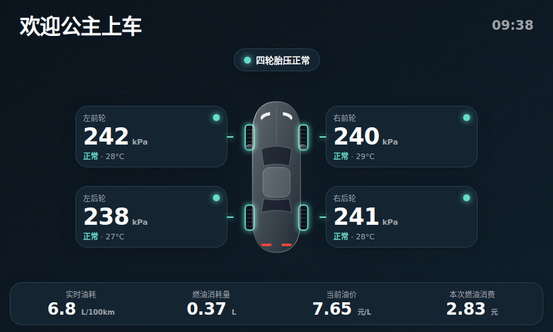
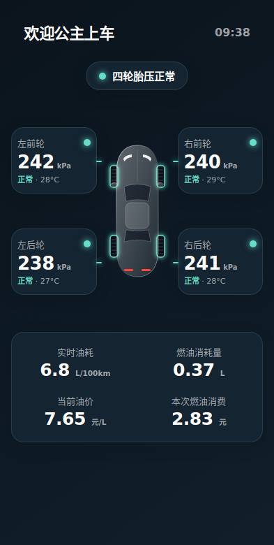

# CarLink Lab

Android 手机端车辆互联与 TPMS 仪表实验项目，重点面向 2015/2016 Hyundai Tucson TL 1.6T G4FJ 与支持百度 CarLife 的现代/起亚车机。

> 这是一个面向自有车辆、互操作研究和停车调试的实验项目。它不是百度官方 CarLife 客户端，也无法把 Android 手机合法地伪装成 Apple CarPlay 设备。

当前版本：**0.14.1**（Android 8.0+）。

*新版车机界面预览，使用模拟数据；图片不代表真实车辆读数。*

## 功能

- Android 前台服务维持 CarLife TCP 通道和 WiFi ELM327 连接，并持有 CPU / WiFi 锁。
- 在手机与 CarLife 车机之间建立本地 TCP 通道，发送 H.264 仪表画面。
- 通过 WiFi ELM327 轮询 Hyundai Mode 21 TPMS 数据，分别显示四轮胎压与胎温。
- 读取标准 OBD-II 燃油数据，显示实时油耗、本次消耗量、油价和本次消费；胎压不可用时继续读取燃油。
- 使用 HTML/CSS/SVG 与 WebView 渲染深色卡片仪表，适配车机横屏和手机竖屏。
- 手机首页提供唯一的功能入口；连接页支持独立轮胎卡片、可折叠日志和后台运行设置。
- 支持自定义欢迎标题、油价省份和汽油标号，保存 ELM327 地址与端口。
- 缺失或过期数据显示 N/A 或“—”；胎压异常以颜色区分。

## 0.14.1 更新

- 内部版本号提升到 24，支持覆盖安装内部版本号为 23 的旧调试包；功能沿用 0.14.0。

## 0.14.0 更新

- 删除手机首页重复的功能按钮，统一界面配色与布局。
- 打通燃油读取到手机和车机显示的链路，兼容多种标准 OBD 响应格式。
- 胎温换算从 `raw - 40` 修正为 `raw - 50`，消除已知的 10°C 偏差；独立处理每轮缺失温度，拒绝不完整或乱序报文。
- 系统重启后台服务时恢复保存的连接地址，重新进入页面时恢复服务状态和最后读数。
- 增加省电限制状态与系统设置入口；停止服务时取消任务并释放资源，连接日志限制长度。
- 修复蓝牙权限及 USB 广播注册的静态检查错误。

## 兼容性与验证状态

项目此前面向 2015/2016 Hyundai Tucson TL 1.6T G4FJ、原生支持 CarLife 的 800×480 车机及 WiFi ELM327 进行开发与调试。最低系统版本为 Android 8.0（API 26）。TPMS 使用请求头 `7D6`、请求 `21 06`、响应 `61 06`。

0.14.0 已通过 APK 构建、Android Lint（无错误，仍有警告）、17 项标准 OBD / TPMS / 模拟 ELM 燃油回归检查，以及 800×480 横屏和 393×780 竖屏浏览器布局检查。**本版本尚未完成小米 14 Ultra 锁屏、真实 ELM327 和车机视频的实机联调。**

不同市场、年款、ECU、车机固件和适配器可能使用不同端口、CAN 地址或数据布局。请先保存原始日志，再修改协议代码。

## 快速开始

### 构建

要求 JDK 17、Android SDK Platform 35 和对应的 Build Tools。Gradle Wrapper 会下载项目指定的 Gradle 版本；首次构建需要网络及已接受的 SDK 许可。

Linux / WSL：

~~~bash
# ANDROID_HOME 指向 Linux 文件系统中的 Android SDK。
# 也可以在本地、未纳入 Git 的 local.properties 中配置 sdk.dir。
bash ./gradlew assembleDebug lintDebug
~~~

Gradle 默认将 APK 写入 Linux 项目目录下的 `app/build/outputs/apk/debug/app-debug.apk`。将交付包保存到 Linux 输出目录：

~~~bash
mkdir -p "$HOME/outputs/CarLink-Lab"
cp app/build/outputs/apk/debug/app-debug.apk \
  "$HOME/outputs/CarLink-Lab/CarLink-Lab-0.14.1.apk"
~~~

Windows 构建入口（仅供 Windows 开发环境使用）：

~~~powershell
.\gradlew.bat assembleDebug lintDebug
~~~

调试 APK 使用构建环境中的调试签名。覆盖安装需要与旧版使用相同的签名，仅文件名和版本号一致并不足以保证可覆盖安装。

### 使用

1. 手机连接 WiFi ELM327。
2. 打开 CarLink Lab，点击“连接车辆与实时仪表”。
3. 设置欢迎标题、油价省份、汽油标号、ELM327 IP 和端口。
4. 允许应用通知，点击“开始”，确认前台服务通知出现。
5. 在手机开发者选项中启用 USB 调试。
6. 通过 USB 连接车机并启动车机端 CarLife。
7. 停车状态下确认 TPMS、燃油和视频画面。

“仪表外观预览 · 演示数据”使用模拟数据；真实车辆读数位于连接页面及 CarLife 车机画面。

### 小米 / HyperOS 后台运行

在连接页点击“后台运行设置”，按系统提示允许忽略电池优化；在应用信息中将省电策略设为“无限制”，允许后台自启动，并保留应用通知。菜单名称可能随 HyperOS 版本变化，以手机实际设置为准。

启动连接后，锁屏数分钟，再打开应用确认数据继续更新。前台服务与唤醒锁不能保证绕过所有厂商后台限制；系统强制停止应用后需手动重新启动。

手机竖屏仪表预览（模拟数据）

## 数据流

~~~text
WiFi ELM327 -- OBD/TPMS --> TucsonTpmsDataSource
                                  |
                                  v
                         TpmsSnapshot
                                  |
CarLife head unit <-- H.264 <-- H264FrameEncoder
                                  ^
                                  |
                      WebViewDashboardRenderer
                                  ^
                                  |
                  app/src/main/assets/tpms_template.html
~~~

详细说明见 [docs/ARCHITECTURE.md](docs/ARCHITECTURE.md)。

## TPMS 与燃油

本项目当前针对目标车辆使用：

- 压力：rawPressure / 4 * 6.894757 kPa
- 温度：rawTemperature - 50 摄氏度
- 轮位：记录 1-4 对应左前、右前、左后、右后
- 燃油流量：优先 `015E`；不可用时使用 `0110` MAF 估算。
- MAF 假设：汽油空燃比 14.7、密度 745 g/L；流量为 `MAF / 14.7 / 745 × 3600` L/h。
- 实时油耗：车速 `010D` 大于 5 km/h 时，显示 `流量 / 车速 × 100` L/100km；不超过 5 km/h 时显示 L/h。
- 缺失车速时不显示瞬时油耗；缺失流量时不沿用旧值，不完整采样或断连期间不累计该段燃油。
- 页面在读数超过约 30 秒未更新时清除过期数据显示。
- 油价默认使用第三方接口，可在设置中更换省份和汽油标号

温度偏移参考 [OBDb Tucson 协议定义](https://github.com/OBDb/Hyundai-Tucson/blob/main/signalsets/v3/default.json)。该公开定义与项目既有传感器 ID 布局存在差异，当前保留原有压力与轮位布局，具体 ECU 版本需要用实车 `2106` 报文核对。修正偏移意味着原来的 43°C 将变为约 33°C；不能据此保证读数与环境温度一致。

燃油流量的 MAF 备用计算及累计消耗量属于估算，不能替代车辆标定数据。第三方油价接口可能随时变更或不可用，项目不保证其持续工作。

## 隐私

- 不包含遥测、账号系统或广告 SDK。
- 不主动上传车辆数据。
- 运行时会访问用户配置的 ELM327 地址和第三方油价接口。
- 提交 Issue 前请删除日志中的 VIN、位置、手机号、IP、车牌和账号信息。
- 不要把签名密钥、token、密码或原始私有日志提交到 Git。

## 法律与安全

- 与 Baidu、Apple、Hyundai、Kia 或其关联公司无隶属或授权关系。
- CarLife、CarPlay、Hyundai、Kia 等名称和商标归各自权利人所有。
- 本项目不包含第三方固件、官方客户端代码或认证芯片绕过方案。
- 协议逆向仅用于互操作研究和用户自有车辆。
- 使用者需自行确认当地法律、车辆保修条款和第三方服务条款。
- 禁止在驾驶过程中操作手机或调试界面。
- 不得将本项目用于未授权车辆、绕过安全认证或破坏车辆系统。

完整说明见 [docs/LEGAL.md](docs/LEGAL.md)。

## 参与开发

请先阅读 [CONTRIBUTING.md](CONTRIBUTING.md)、[SECURITY.md](SECURITY.md) 和 [CODE_OF_CONDUCT.md](CODE_OF_CONDUCT.md)。

提交协议适配时，请提供可复现步骤和数据来源，不要提交 VIN 或其他隐私信息。发布前检查 [docs/OPEN_SOURCE_CHECKLIST.md](docs/OPEN_SOURCE_CHECKLIST.md)。

## 许可证

MIT License，见 [LICENSE](LICENSE)。第三方依赖和商标不适用 MIT License。
