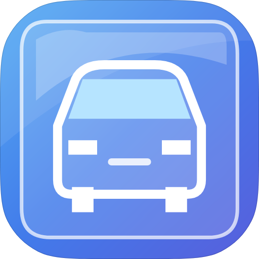
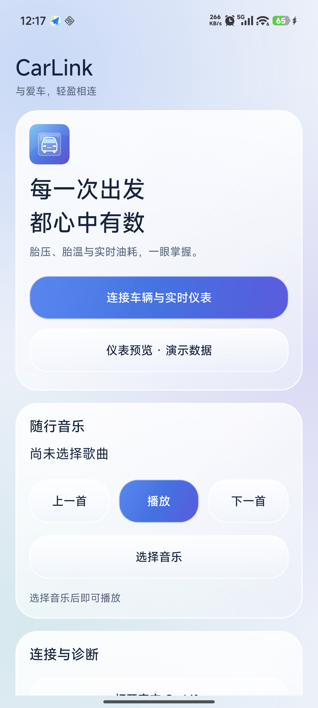
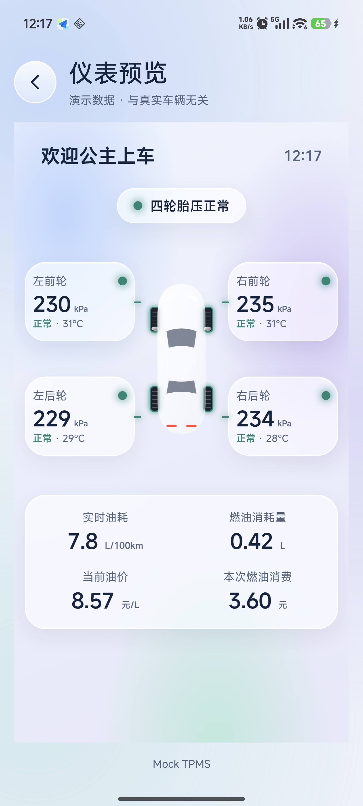

# 0.15.0 界面检查记录

检查设备：小米 14 Ultra（aurora），1440×3200，560dpi。覆盖安装保留连接参数与仪表偏好。

## 实现与发现

六个原生页面统一采用浅色渐变背景、半透明圆角卡片、高光边缘和蓝紫操作按钮。玻璃效果参考 [Apple Materials](https://developer.apple.com/design/human-interface-guidelines/materials)，使用 Android 原生 Drawable 与 WebView CSS 实现。车机仪表使用深色玻璃配色。

扫描与通道页原来的四列操作过于拥挤，现拆成两列；320dp 窄屏或字体缩放达到 1.25 时改成纵向排列。音乐控制取消负边距。全页内容可以滚动，输入框、返回与操作按钮的触控尺寸至少 48dp，参照 [Android 触控尺寸指南](https://developer.android.com/guide/topics/ui/accessibility/views/apps-views)。

透明系统栏让背景延伸到状态栏与手势区域；系统栏、摄像头和键盘的 Insets 为内容预留安全距离。Android 8.0 保留深色导航栏以保证白色系统按钮可读。

实机截图发现 WebView 在高密度显示器上使用真实屏幕密度，原先的低密度 Context 不能保证期望的 CSS 视口。现按真实密度排布 WebView，按目标输出比例绘制；手机预览使用屏幕密度输出清晰位图，车机仍输出 800×480。

## 自动测量

| 手机显示配置 | 页面数量 | 按钮重叠 | 按钮文字裁切 | 小于 48dp 的操作区 |
| --- | ---: | ---: | ---: | ---: |
| 411dp，字体 1.0 | 6 | 0 | 0 | 0 |
| 411dp，字体 1.3 | 6 | 0 | 0 | 0 |
| 320dp，字体 1.3 | 6 | 0 | 0 | 0 |
| 914dp 横屏模拟，字体 1.0 | 6 | 0 | 0 | 0 |

合计 24 次页面测量、172 次控件检查。`LayoutAuditInstrumentation` 直接读取实际 View 的尺寸、位置和文字排版，包含滚动容器中屏幕外的操作区。UIAutomator 截图中的局部可见控件可能被滚动窗口裁切，不能据此判断实际按钮触控尺寸不足。

仪表通过 800×480、393×780、379×655、320×640、320×480 五种浏览器视口检查：卡片无重叠、内容无溢出。页面仍逐页进行实机截图复查。

音乐选择器打开与取消、日志展开/收起、返回首页通过操作检查。键盘弹出时，输入区位于安全内容区域内，已结合实机截图确认。最终清晰度优化安装包另通过六页普通字体复查。

原用户偏好保持一致；油价缓存更新时间和 Chromium 特性缓存会随运行正常更新。

构建与 Android Lint 通过；17 项标准 OBD、TPMS、模拟 ELM 燃油回归通过。检查后恢复原手机显示大小、字体与旋转设置。

## 复现

构建测试包：`bash gradlew assembleDebug assembleDebugAndroidTest lintDebug`。测试包与应用需采用相同签名。安装后执行：

```bash
adb shell am instrument -w \
  io.github.carlinklab.test/io.github.carlinklab.LayoutAuditInstrumentation
```

结果 `layout_report` 含每页宽度、字体缩放、操作区数量及三类异常；`launcher_icon_png` 是当前应用自适应图标的 PNG Base64。修改显示或字体设置后重新运行，并在结束后恢复原配置。

## 截图与边界







仪表截图使用模拟数据。以上检查验证界面、安装与数据解析回归；真实 ELM327、车机视频及锁屏持续运行需要车辆联调。
